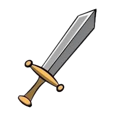
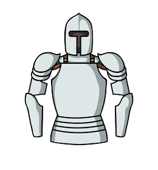
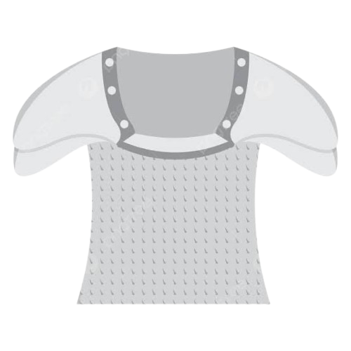

# ku_hsd_2026_23
<!DOCTYPE html>
<!--- Hi-->
<html lang="en"> 
<head>
    <meta charset="UTf-8">
<title> Gunter's Forge</title>
<link rel="stylesheet" href="styles.css">
</head>
<body>
    
    <h1> Welcome to Gunter's Forge</h1>
    

    

    
    <button id="Sword_Purchase">Sword</button>
    

    

    
    <button id="PlateArmor_Purchase">Plate Armor</button>
    

    

    
    <button id="ChainMail_Purchase">Chain Mail</button>
    

    

    
    <button id="CookingPot_Purchase">Cooking Pot</button>
    

<a href="To-Do.html">
<button id="ToDoList">Gunter's To-Do List</button>
</a>
</body>
</html>